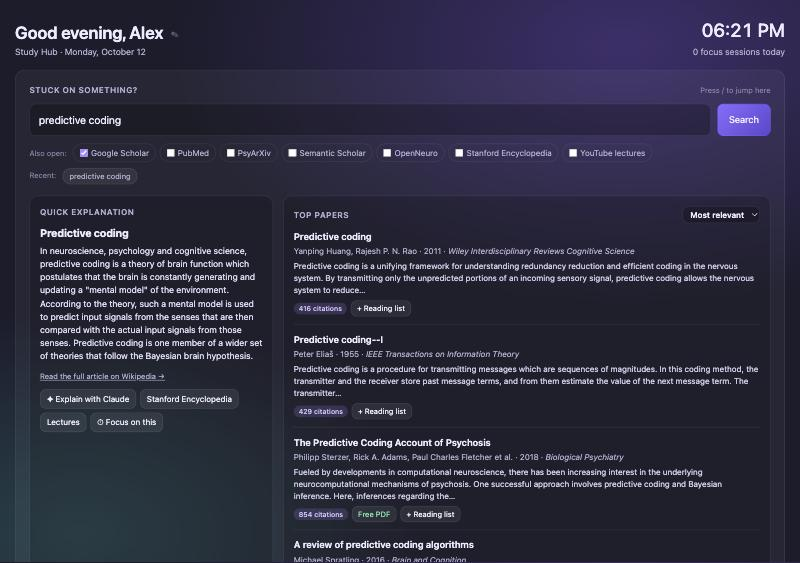

# Study Hub

A single-file study dashboard for researchers and students, built for cognitive science. When you're stuck on a topic, type it once and get a plain-language explanation and the top papers on one page, then keep a focus timer, tasks, a reading list and notes next to them.

## Features

- **"Stuck on something?" search**
  - A quick explanation from Wikipedia
  - Eight top papers from [OpenAlex](https://openalex.org) (250M+ scholarly works), with authors, year, journal, a short abstract, citation count and free PDF links when available
  - Sort by most relevant, most cited, newest, or reviews only
  - One-click "Explain with Claude", Stanford Encyclopedia of Philosophy and lecture searches
  - Optional extra tabs for Google Scholar, PubMed, PsyArXiv, Semantic Scholar, OpenNeuro, SEP and YouTube
- **Focus timer:** 25/50-minute focus and 5/15-minute break modes, labelled with your topic. It keeps a 7-day chart, a daily streak and a session log, and shows a notification when time is up.
- **Reading list:** save papers from search results, or paste a DOI to see the paper's details and copy an APA 7 citation.
- **Study tasks, a "My shelf" of links and files you open often, and a scratchpad** that saves as you type and exports to Markdown.
- **Quick reference tabs:** choosing a stats test, brain regions, EEG frequency bands, ERP components, `lme4` mixed-model syntax and a three-pass method for reading a paper.

## Use it

1. Download `index.html`, or clone the repo.
2. Open it in your browser (Chrome, Safari, Firefox, Edge or Brave).
3. Click ✎ next to the greeting to set your name.

There's nothing to install and no account. Search and DOI lookup need an internet connection.

**Tip:** press `/` anywhere on the page to jump to the search box.

## Privacy

There is no server and no tracking. Your tasks, notes, reading list and focus history are stored only in your browser's `localStorage`. When you search, the query goes straight from your browser to the public Wikipedia and OpenAlex APIs.

## License

MIT
